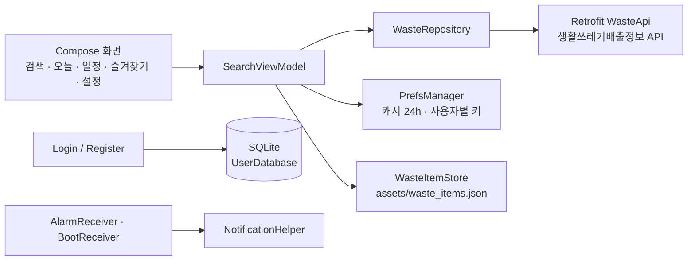

# ♻️ 분리배출 도우미 (RecycleHelper)

> 품목 검색으로 분리배출 방법을 알려주고, 우리 동네 수거 요일에 맞춰 알림을 보내는 안드로이드 앱

---

### 🎥 시연 영상
## ▶️ [Watch on YouTube](https://youtube.com/shorts/ABwxvWd3vkU)

<a href="https://youtube.com/shorts/ABwxvWd3vkU">
  
</a>

---

## 📋 작품 설명

### 💬 개발 개요
#### 1. 개발 배경 및 필요성

&nbsp;&nbsp;분리배출 기준은 품목마다 다르고, 치킨 박스나 컵라면 용기처럼 헷갈리는 품목은 매번 검색해 봐야 한다. 게다가 생활쓰레기 수거 요일과 시간은 지역마다 달라서, 이사를 하거나 처음 자취를 시작하면 언제 무엇을 내놓아야 하는지 알기 어렵다. 이런 불편을 줄이기 위해 **품목별 배출 방법과 동네 수거 일정을 한 앱에서 확인**할 수 있는 도우미가 필요했다.

#### 2. 개발 목표

> 품목 이름만 입력하면 배출 방법·장소·주의사항을 보여주고, 공공데이터 API로 받은 지역별 수거 일정에 맞춰 "오늘 버릴 수 있는 쓰레기"와 배출 알림을 제공하는 앱을 구현하는 것을 목표로 한다.

* 품목명·키워드로 **분리배출 방법 검색** (로컬 품목 데이터 211개)
* 행정안전부 **생활쓰레기배출정보 API**로 시/구별 수거 요일·시간 조회
* 현재 요일 기준 **오늘 배출 가능한 쓰레기**와 주간 배출 일정 표시
* 배출 전날·당일 **알림**과 월별 배출 기록 **통계**
* 회원가입/로그인으로 **사용자별 즐겨찾기·설정 분리**

#### 3. 세부 개발 목표

- **단계별 검색**  
  정확한 품목명을 몰라도 결과가 나오도록 완전 일치 → 부분 일치 → 키워드 → 세부 분류 → 폐기물 그룹 순서로 넓혀 가며 찾는다.

- **빠른 지역 정보 로딩**  
  공공 API의 여러 페이지를 병렬로 요청하고, 지역별 결과를 24시간 캐싱해 같은 지역은 다시 호출하지 않는다.

- **놓치지 않는 알림**  
  원하는 요일·시간·쓰레기 종류만 골라 알림을 받고, 기기를 재부팅해도 알림이 유지되게 한다.

- **사용자별 데이터 분리**  
  즐겨찾기·검색 기록·배출 기록을 계정마다 따로 저장해 한 기기에서 여러 사용자가 쓸 수 있게 한다.

---

### ⚙️ 개발 환경 설명
#### 1. 개발 환경

* **언어**: Kotlin 2.0.20
* **UI**: Jetpack Compose + Material3
* **아키텍처**: MVVM (`SearchViewModel` → `SearchUiState`)
* **네트워크**: Retrofit 2.11 · OkHttp 4.12 · Gson
* **저장소**: SQLite(회원) · SharedPreferences(설정·캐시·기록) · assets JSON(품목 데이터)
* **알림**: AlarmManager · BroadcastReceiver
* **SDK**: minSdk 26 (`java.time` 사용) / targetSdk 34

#### 2. 앱 구조



#### 3. 품목 검색 흐름

1) 입력한 검색어의 공백을 제거하고 정규화
2) 선택한 카테고리(재활용·일반·음식물·유해·대형·폐가전·의류·공사장·기타)로 먼저 필터링
3) 품목명 완전 일치 → 부분 일치 → `keywords` → `subCategory` → `wasteGroup` 순서로 매칭해 중복 없이 결과에 추가
4) 결과가 없으면 추천 검색어와 추천 카테고리를 보여줌
5) 검색어는 최근 검색어 10개까지 저장

> 품목 데이터는 211개 품목이 20개의 배출 방법 템플릿을 참조하는 구조라, 같은 배출 방법을 품목마다 반복해서 적지 않는다.

#### 4. 지역 수거 정보 조회 흐름

1) 설정에서 시/구를 선택하면 먼저 SharedPreferences 캐시를 확인
2) 캐시가 있으면 바로 화면에 표시하고, 24시간이 지나지 않았으면 API 호출을 생략
3) 캐시가 없거나 만료되면 API 1페이지로 `totalCount`를 확인한 뒤, 나머지 페이지를 코루틴 `async` / `awaitAll`로 동시에 요청
4) 응답의 배출 요일 문자열을 `DayOfWeek` 목록으로 파싱해 오늘 배출 탭과 주간 일정에 반영

#### 5. 알림 흐름

1) 알림 설정에서 시간, 며칠 전에 알릴지, 알림 받을 쓰레기 종류를 선택
2) `AlarmManager.setRepeating`으로 하루 한 번 `AlarmReceiver` 실행
3) 선택한 쓰레기 종류를 본문에 담아 당일/전날 문구로 알림을 표시하고, 누르면 오늘 탭(당일) 또는 일정 탭(전날)으로 이동
4) 재부팅 시 반복 알람이 사라지므로 `BootReceiver`가 알람을 다시 등록

---

### 📝 개발 프로그램 설명
#### 1. 화면 구성

| 탭 | 기능 |
| --- | --- |
| **검색** | 품목 검색, 카테고리 필터, 최근 검색어, 지역 선택 |
| **오늘** | 현재 요일 기준 배출 가능한 쓰레기 종류와 수거 시간 |
| **일정** | 주간 배출 캘린더, 요일별 배출 완료 체크 |
| **즐겨찾기** | 별표로 저장한 품목 목록 (앱 재시작 후에도 유지) |
| **설정** | 지역·알림 설정, 월별 통계, 로그아웃 |

> 품목 상세, 월별 통계, 알림 설정은 전체 화면 오버레이로 띄운다. 통계 화면에서는 이번 달 배출 완료·즐겨찾기·검색 횟수를 합산한 환경 실천 점수(최대 100점)를 보여준다.

#### 2. 파일 구성

<details>
<summary><b>UI (Jetpack Compose)</b></summary><br>

- `ui/auth/` — `LoginActivity`, `RegisterActivity` (회원가입 유효성 검사, 게스트 모드)
- `ui/search/` — `SearchScreen`, `SearchViewModel` (검색 로직, UI 상태 관리)
- `ui/today/` · `ui/calendar/` · `ui/favorites/` · `ui/settings/` — 하단 탭 화면
- `ui/detail/` · `ui/stats/` · `ui/notification/` — 상세 · 통계 · 알림 설정 오버레이
- `ui/components/` — `RecycleItemCard`, `RegionPickerDialog`
</details>

<details>
<summary><b>데이터</b></summary><br>

- `data/remote/` — `RetrofitClient`, `WasteApi`, 응답 DTO
- `data/repository/WasteRepository.kt` — API 병렬 조회, 수거 정보 파싱
- `data/local/WasteItemStore.kt` — `assets/waste_items.json` 품목 데이터 로드
- `data/prefs/PrefsManager.kt` — 사용자별 키로 설정 · 캐시 · 기록 저장
- `data/auth/` — `UserDatabase`(SQLite), `UserSessionManager`
- `util/PasswordHashUtil.kt` — 비밀번호 SHA-256 해시
</details>

<details>
<summary><b>알림</b></summary><br>

- `notification/NotificationHelper.kt` — 알림 채널 생성, 반복 알람 등록
- `notification/AlarmReceiver.kt` — 알람 수신 후 배출 대상 확인 및 알림 표시
- `notification/BootReceiver.kt` — 재부팅 후 알람 재등록
</details>

#### 3. 실행 방법

1. [공공데이터포털](https://www.data.go.kr)에서 **행정안전부 생활쓰레기배출정보** API 키 발급
2. 프로젝트 루트의 `local.properties`에 API 키 추가
   ```properties
   WASTE_API_KEY=YOUR_API_KEY_HERE
   ```
3. Android Studio에서 프로젝트를 열고 Gradle Sync
4. 에뮬레이터 또는 실기기(Android 8.0, API 26 이상)에서 실행
5. 검색창에 `페트병`, `치킨박스`, `건전지`, `스티로폼` 등을 입력해 확인

#### 4. 권한

| 권한 | 용도 |
| --- | --- |
| `INTERNET` | 공공 API 호출 |
| `POST_NOTIFICATIONS` | Android 13 이상 알림 표시 |
| `RECEIVE_BOOT_COMPLETED` | 재부팅 후 알림 재등록 |

---

## 🖥️ 개발 언어
<span>
  
</span>

## 🖥️ 개발 도구 / 라이브러리
<span>
  
  
  
  
</span>
